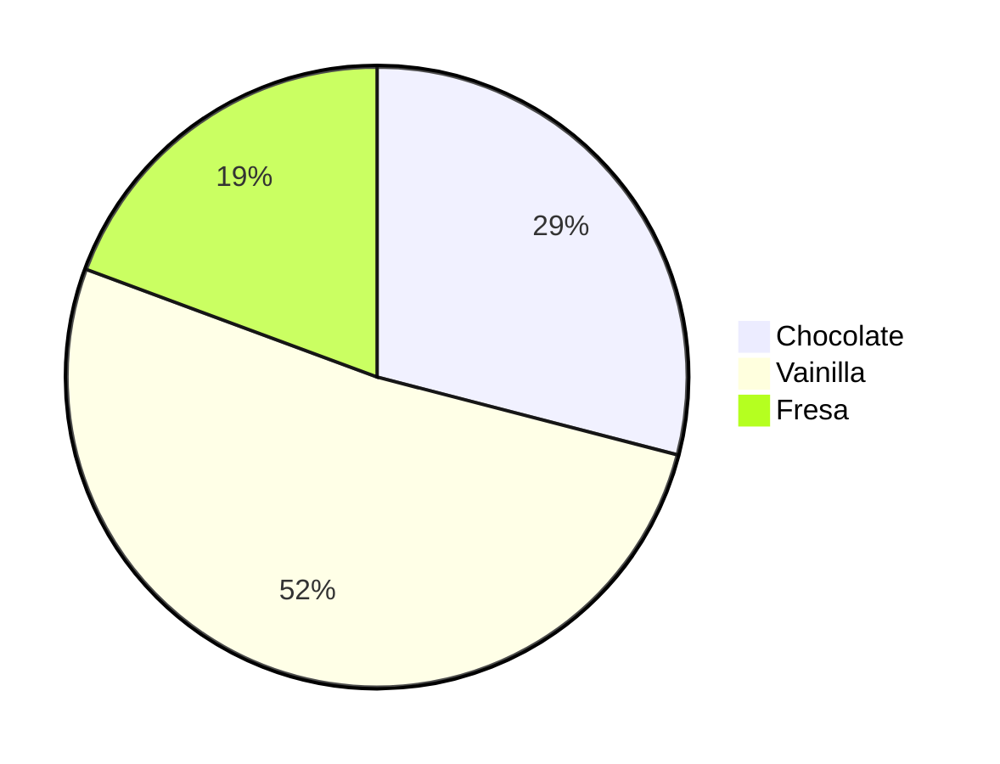
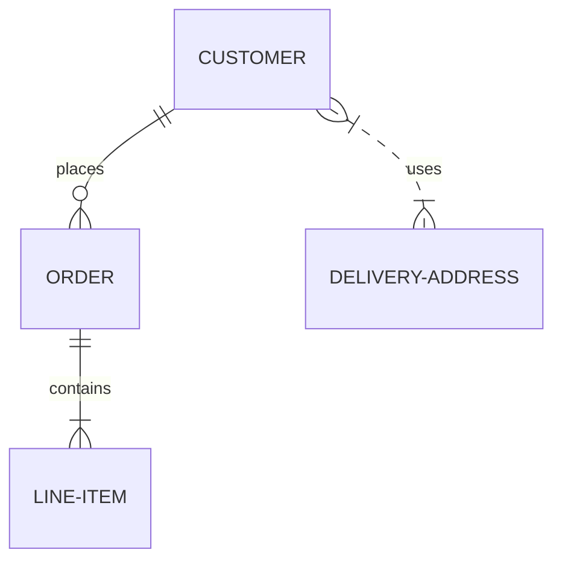
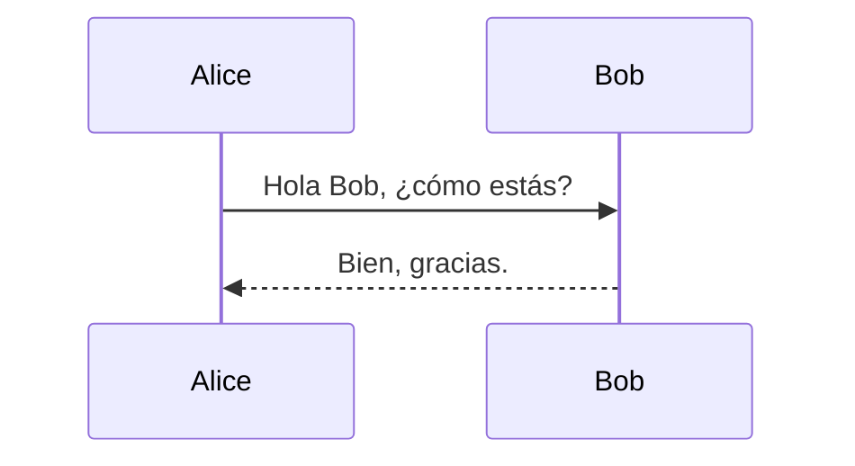
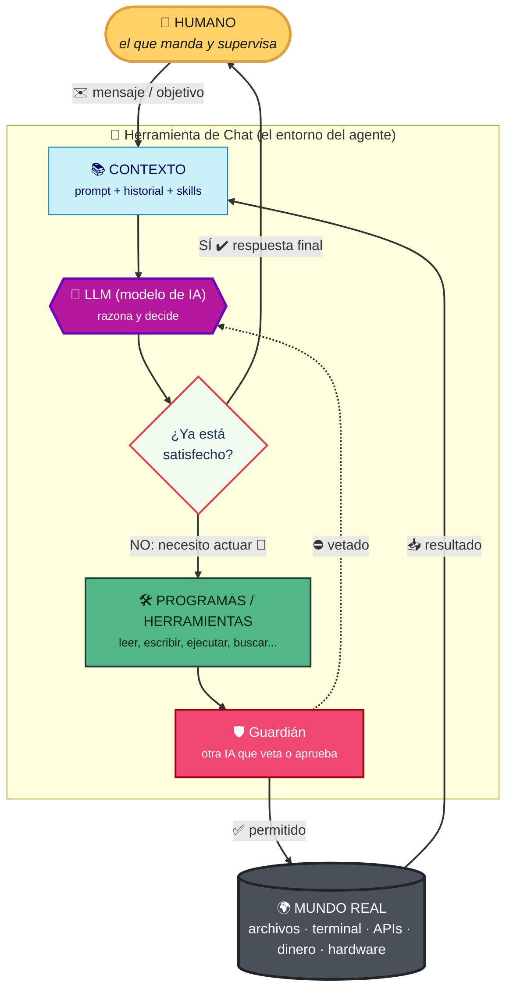

Markdown es un formato para escribir documentos con ESTRUCTURA y FORMATO, permitiendo incluir títulos, listas, enlaces, imágenes, tablas y otros elementos de manera sencilla... solo mediante CARACTERES DEL TECLADO

# Esto es un título

## Esto es un subtítulo

### Esto es un subtítulo de tercer nivel

#### Esto es un subtítulo de cuarto nivel

##### Esto es un subtítulo de quinto nivel

###### Esto es un subtítulo de sexto nivel

Luego puedo escribir texto normal.
Dentro de un texto puedo aplicar algo de formato:
Por ejemplo, puedo poner palabras en *cursiva*, las puedo poner en **negrita**.
Incluso puedo poner palabras en negrita y en cursiva al mismo tiempo usando ***así***.

Puedo tacahar cosas, como : ~~esto~~
Incluso puedo marcar una palabra como `código` o palabra `literal` usando las comillas invertidas.

Es muy rápido. Odiamos el WORD... es muy lento. poner algo en negrita, cursiva, título, nos obliga a coger el ENDEMONIADO RATON! Y eso nos hace ir lentos.
Cuando manejo bien un teclado, no quiero quitar las manos de él para usar el ratón. Markdown me permite formatear texto de manera rápida y eficiente sin tener que depender del ratón.

Hay 300k herramientas que permniten FORMATEAR texto usando Markdown de manera rápida y eficiente... generando documentos WORD, PDF, HTML y otros formatos sin tener que depender del ratón.

En el mundo del desarrollo de software, toda la documentación, desde los README hasta los manuales de usuario, se beneficia enormemente del uso de Markdown. Permite a los desarrolladores escribir documentación clara y estructurada de manera rápida y eficiente, manteniendo el enfoque en el contenido sin distraerse con el formato.

Podemos poner listas:
- Y este sería un elemento de una lista
- Y este otro
- Y este otro
  + Esto sería una sublista
  + Y este sería otro elemento de la sublista
    * Esto sería una sublista
    * Y este sería otro elemento de la sublista
- Y este sería otro elemento de la lista principal

Puedo poner listas numeradas:
1. Primer elemento de la lista numerada
2. Segundo elemento de la lista numerada
    1. Primer elemento de la lista numerada
    2. Segundo elemento de la lista numerada
    3. Tercer elemento de la lista numerada
3. Tercer elemento de la lista numerada

Puedo poner listas de tareas:
- [ ] Tarea pendiente
- [x] Tarea completada
- [ ] Otra tarea pendiente

# Recetas

| Receta | Ingredientes | Instrucciones | Tiempo de preparación | Dificultad |
|--------------|--------------|--------------|:--------------------:|-----------:|
| Torta de chocolate | Harina, azúcar, cacao, huevos, mantequilla | Mezclar los ingredientes y hornear | 45 minutos | Media |
| Ensalada César | Lechuga, pollo, crutones, queso parmesano, aderezo César | Mezclar todos los ingredientes | 15 minutos | Fácil |
| Spaghetti a la Boloñesa | Spaghetti, carne molida, tomate, cebolla, ajo, aceite de oliva | Cocinar la carne y la salsa, luego mezclar con el spaghetti | 30 minutos | Media |
| Pizza Margherita | Masa de pizza, tomate, mozzarella, albahaca | Preparar la masa, agregar los ingredientes y hornear | 20 minutos | Fácil |

# Código en lenguajes informáticos:

```java
public class HolaMundo {
    public static void main(String[] args) {
        System.out.println("Hola, mundo!");
    }
}
```

```cobol

       IDENTIFICATION DIVISION.
       PROGRAM-ID. HolaMundo.

       PROCEDURE DIVISION.
           DISPLAY "Hola, mundo!".
           STOP RUN.
```

Hay algunos/algunAs compañer@s que podemos pensar que nosotros no vamos a usar lenguajes informáticos... NO DEBERIAMOS PENSAR ESO!
No he puesto LENGUAJES DE PROGRAMACION, he puesto LENGUAJES INFORMÁTICOS.

Y hay un lenguaje informático que usamos UNA BARBARIDAD EN ESTOS DOCUMENTOS: MERMAID (sirena)

Es un lenguaje que me permite ESCRIBIR gráficos.
No he dicho DIBUJAR gráficos... he dicho ESCRIBIR gráficos mediante código.
Tiene decenas de tipos de gráficos:

# Grafico de tarta



## Diagrama entidad relacion de una BBDD



## Diagramas de secuencia:



Pero lo mejor no es esto!
Lo mejor es que esto no es sino un LENGUAJE MAS...
Y hay quien sabe escribir en cualquier lenguajes (especialmente en lenguajes formales) MUCHO MEJOR QUE YO: IAs.

## Diagrama de flujo (el bucle agéntico de las IAs)



# Enlaces:

- [Mermaid](https://mermaid-js.github.io/mermaid/#/) - Documentación oficial de Mermaid para crear diagramas.

# Emails:

<> - Dirección de correo electrónico de contacto.
Ejemplo:
<contacto@ejemplo.com>

# Imágenes

Como los enlaces, pero con un cierre de admiración delante:


Este formato es el que :
- Usamos nosotros para escribir documentos
- Usamos nostros para dar instrucciones FIJAS a las IAs
- Escriben las propias IAs

Podemos luego convertir de este formato a otros.
Incluso puedo pedirlo a la IA.